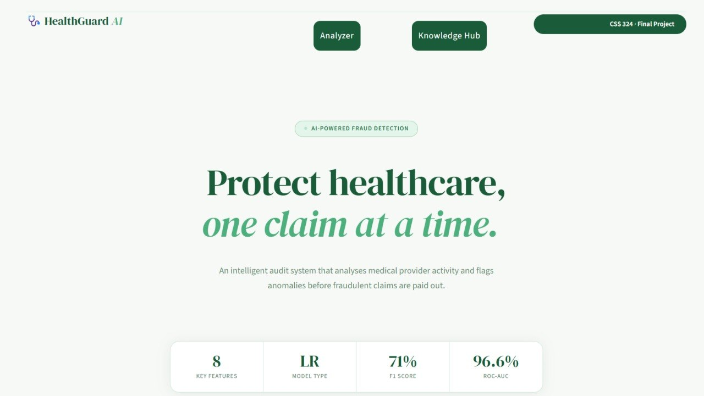
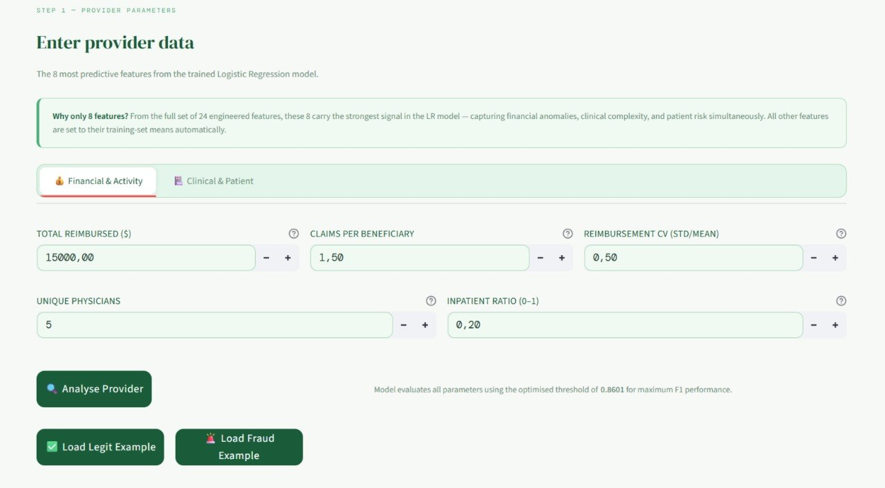
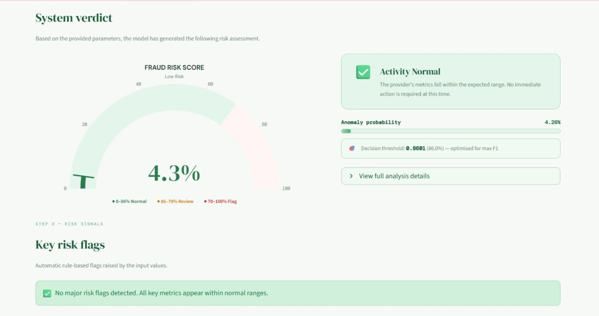

# HealthGuard AI: Healthcare Provider Fraud Detection

Final project for **Introduction to Machine Learning**.

The project detects fraudulent Medicare providers from aggregated claims data. It covers the full pipeline: data cleaning, feature engineering, model comparison, threshold optimisation and an interactive **Streamlit** demo.

## Problem

Medicare fraud costs the U.S. tens of billions of dollars per year. Typical schemes include upcoding, billing for deceased patients (ghost billing) and service over-utilisation. Given a provider's aggregated claims, the model predicts whether the provider is **fraudulent or legitimate**.

Only 9.4% of providers are fraudulent (506 of 5,410), so the task is strongly imbalanced and is evaluated with F1 and recall rather than accuracy.

## Dataset

[Healthcare Provider Fraud Detection Analysis](https://www.kaggle.com/datasets/rohitrox/healthcare-provider-fraud-detection-analysis) (Kaggle). Four files are merged at provider level:

| File | Description | Rows |
|---|---|---|
| `Train.csv` | Provider fraud labels | 5,410 |
| `Train_Beneficiarydata` | Patient demographics and chronic conditions | 138,556 |
| `Train_Inpatientdata` | Hospital admission claims | 40,474 |
| `Train_Outpatientdata` | Outpatient visit claims | 517,737 |

> The raw CSV files are not stored in this repository. Download them from Kaggle and set `DATA_DIR` in the notebook.

## Method

- **Cleaning:** label encoding, date parsing, age derivation, chronic-condition recoding, dropping columns with more than 80% missing values, deduplication.
- **Feature engineering (24 provider-level features):** `TotalReimbursed`, `ReimbursementCV`, `MeanDiagnosisCount`, `PctDeceasedPatients`, `ClaimVelocity`, `PhysicianConcentrationHHI`, `ReimbursementSkewness` and others.
- **Imbalance handling:** SMOTETomek, F1-tuned hyperparameters (`RandomizedSearchCV`), F1-optimal decision threshold.
- **Models:** Logistic Regression, Random Forest, XGBoost, LightGBM, Stacking Ensemble.

## Results (held-out test set)

| Model | ROC-AUC | F1 | Recall | Precision |
|---|---|---|---|---|
| **Logistic Regression** (threshold 0.86) | **0.9659** | **0.710** | 0.703 | 0.717 |
| Stacking Ensemble | 0.9555 | 0.667 | 0.733 | 0.612 |
| LightGBM | 0.9550 | 0.658 | 0.713 | 0.610 |
| XGBoost | 0.9515 | 0.654 | 0.842 | 0.535 |
| Random Forest | 0.9504 | 0.637 | 0.772 | 0.542 |

Threshold tuning raised the F1 of the final model from 0.575 to 0.710. For maximum fraud coverage, XGBoost at threshold 0.40 reaches a recall of 0.842.

## Demo app

**HealthGuard AI** is a Streamlit app with two pages:

- **Analyser:** enter 8 key provider features and get a fraud probability, a verdict based on the optimised threshold, rule-based risk flags and a feature chart. Two buttons load example legitimate and fraudulent profiles.
- **Knowledge Hub:** short educational material on healthcare fraud schemes and prevention.

### Screenshots





### Run locally

```bash
pip install streamlit scikit-learn pandas numpy plotly
streamlit run app.py
```

> **Note:** the trained model file `models/lr_model.pkl` is not included in this repository yet. The app requires it to start.

## Repository contents

| File | Description |
|---|---|
| `app.py` | Streamlit demo application |
| `fraud_detection_health.ipynb` | Data cleaning, EDA, modelling and evaluation |
| `final_report.pdf` | Full project report |
| `landing.png`, `input.png`, `verdict.png` | App screenshots |

## Limitations

- The `PotentialFraud` label is not confirmed ground truth.
- The data is a static snapshot, with no temporal or provider-network features.
- Features are aggregated per provider, which can hide within-provider variation.

## Team

| Name | ID | Primary Contribution |
|---|---|---|
| Stamshalova Zhaniya | 230183073 | Data Cleaning & Preprocessing |
| Orynbassar Nurila | 230183137 | Lead Modeling & Threshold Optimization |
| Kosbay Assylzhan | 230183066 | Streamlit Application Building |
| Duman Madina | 230183070 | Feature Engineering & Visualization |
| Bolatkazy Togzhan | 230183084 | Documentation & Exploratory Data Analysis (EDA) |

*Developed at Suleyman Demirel University (SDU).*
